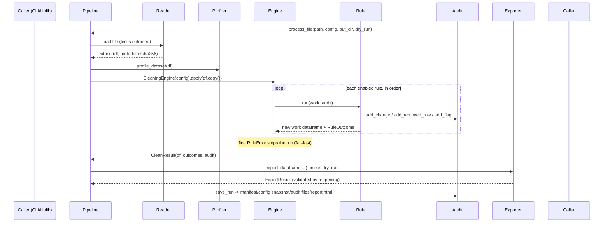

# Architecture

## Design goals

1. **One engine, three interfaces.** The dashboard, CLI, and library all end
   at the same `CleaningEngine`. Interface code never reimplements cleaning
   logic, so behavior cannot drift.
2. **Preview = apply.** `CleaningEngine.preview()` and `.apply()` execute the
   identical `_run()` path on a private copy of the data. The preview is the
   actual outcome, not a simulation. A test asserts summary equality.
3. **Every effect is an audit record.** Rules never mutate data without
   recording a `ChangeRecord`, `RemovedRowRecord`, or `FlagRecord`. The HTML
   report, CSV logs, and JSON trail are all projections of the same collector.
4. **Fail-safe ordering.** Rules run in config order; the first failure stops
   the run (fail-fast) so a half-applied plan is never exported.

## Module map

```
src/data_cleaning_toolkit/
├── config/schema.py        # CleaningConfig + 13 rule configs (Pydantic, extra="forbid")
├── readers/
│   ├── base.py             # Dataset container, metadata, limit checks, format guard
│   ├── csv_reader.py       # encoding cascade, delimiter sniffing, bad-row accounting
│   └── excel_reader.py     # sheet selection, formula-cell detection, cached values
├── profiling/profiler.py   # read-only profile + 0-100 quality score
├── cleaners/
│   ├── base.py             # CleaningRule ABC, registry, RuleOutcome
│   ├── missing.py duplicates.py types.py dates.py
│   ├── strings.py numbers.py units.py custom.py
├── core/
│   ├── engine.py           # CleaningEngine: preview/apply, CleanResult
│   ├── pipeline.py         # file-level orchestration used by CLI
│   └── errors.py           # typed error hierarchy with machine codes
├── auditing/
│   ├── audit.py            # AuditCollector (changes, removals, flags, redaction, cap)
│   └── run_io.py           # run folder writer (manifest, snapshots, CSVs, workbook)
├── validators/             # re-export shim for config/validation helpers
├── exporters/exporters.py  # atomic CSV/XLSX/JSON writes + reopen validation
└── reporting/html_report.py# self-contained HTML reports (inline CSS only)
```

## Execution flow (apply)



`preview` skips the exporter and run writer; everything else is identical.

## Rule contract

```python
class CleaningRule(ABC):
    rule_type: ClassVar[str]
    requires_full_dataset: ClassVar[bool]   # duplicates, outliers, global fills

    @abstractmethod
    def apply(self, df: pd.DataFrame, audit: AuditCollector) -> pd.DataFrame:
        ...  # receive a private copy; return a new frame; record every effect
```

- Rules receive `work = df.copy()` — the caller's frame is never mutated
  (regression-tested).
- The registry (`@register`) maps `type` strings to classes; the engine fails
  fast on unknown types *at config validation*, before reading any file.
- Violation policies (`flag` / `remove_rows` / `set_null`) are shared helpers
  so custom rules behave identically to built-ins.

## Quality score methodology

The profiler score is the mean of three components, each in [0, 100]:

| Component | Definition |
|---|---|
| Completeness | `max(0, 100 − 5 × missing-cell %)` — missing = NaN **or** a text null marker |
| Uniqueness | `max(0, 100 − 5 × duplicate-row %)` — duplicates counted as extra occurrences beyond the first row of each duplicate group |
| Consistency | `max(0, 100 − 100 × consistency-markers ÷ #columns)` — each column contributes one marker per issue kind found: mixed inferred types (one per extra type), multiple units, case variants, embedded null markers |

The multipliers mean 20 % missing → 0 completeness. The score is transparent
and reproducible, not a black box; components are reported alongside it.

## Audit record model

- `ChangeRecord` — rule, row position, column, before, after, reason. Values
  in `audit.redact_columns` are replaced by `[REDACTED]` before storage.
- `RemovedRowRecord` — rule, row, reason, plus the values of
  `audit.key_columns` for provenance ("what was deleted").
- `FlagRecord` — suspicious values left untouched and why.

`AuditCollector.max_change_records` caps stored *detail* for huge runs; the
counters (`total_changes`, per-rule `cells_changed`) are always exact, and the
manifest records how many detail records were dropped.

## Export safety

1. Target exists → refuse (unless explicitly allowed).
2. Write to `.<prefix>tmp` in the destination directory, `os.replace` on
   success, delete on failure — no partial files.
3. Formula-injection guard prefixes risky text with `'` (OWASP CSV injection
   mitigation) and counts the guarded cells.
4. `validate_output=True` reopens the file and checks row counts, headers and
   sample rows against the dataframe that was written.

## Error taxonomy

| Error | Code | Meaning |
|---|---|---|
| `ConfigError` | `config_error` | invalid/missing configuration (CLI exit 2) |
| `DataImportError` / `UnsupportedFormatError` | `import_error` / `unsupported_format` | unreadable or unsupported input |
| `LimitExceededError` | `limit_exceeded` | file/rows/columns over `limits` |
| `RuleError` | `rule_error` | a rule failed at runtime (run stops early) |
| `OutputError` | `output_error` | export/validation failure |
| `SafetyError` | `safety_error` | an operation would violate a safety guarantee (e.g. overwrite) |
